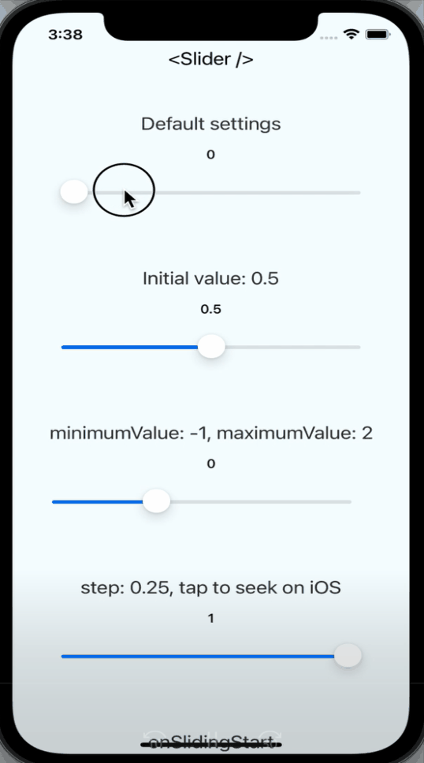
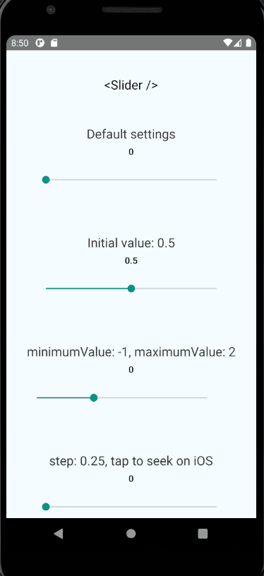

<p align="center">
  <a href="https://www.callstack.com/open-source?utm_campaign=generic&utm_source=github&utm_medium=referral&utm_content=slider" align="center">
    
</p>
<p align="center">
    <a href="https://www.npmjs.com/package/@callstack/slider">
        
    </a>
    <a href="https://github.com/callstack/react-native-slider/actions/workflows/ReactNativeSlider-CI.yml">
        
    </a>
    <a href="https://github.com/callstack/react-native-slider">
        
    </a>
    <a href="https://github.com/callstack/react-native-slider/blob/main/LICENSE.md">
        
    </a>
</p>
<p align="center">
  `@callstack/Slider` component makes native Slider implementations of SwiftUI and Material Design 3 available in React Native.
  <br>Currently supported on following platforms:
</p>

|iOS|Android|
|:-:|:-:|
|||

## Installation & Usage

To install `cd` to your project and:
```
yarn add @callstack/slider
```
or
```
npm install @callstack/slider --save
```
If using iOS please remember to install cocoapods by running: `npx pod-install`

The following code presents the basic usage scenario of this library:
```javascript
import Slider from '@callstack/slider';

// Slider with initial value of 5, taking 80% of container's width
<Slider
  step={1}
  value={5}
  minimumValue={-10}
  maximumValue={10}
  style={{width: "80%"}}
/>
```

Check out the [example project](example) for more examples.

### Reach out on Discord

If you have any questions, issues or any other topic that you need an advise in, reach out to us on our channel on Discord under this 👉 [link](https://discord.com/channels/426714625279524876/1339942689524678737).
<br/>See you there!

## Properties

| Property | Description | Type | Default |
| -------- | ----------- | ---- | ------- |
| `style` | Used to style and layout the Slider. See `StyleSheet.js` and `ViewStylePropTypes.js` for more info. | View.style | |
| `minimumValue` | Initial minimum value of the slider. | number | `0` |
| `maximumValue` | Initial maximum value of the slider. | number | `1` |
| `value` | Value of the slider. Can be used to programmatically control the position of the thumb, and entered once at the beginning it acts as the initial value.<br/>_This is not a controlled component_, you don't need to update the value while the user is dragging.<br/>Ignored by a ranged slider, which is positioned by `valueLeft` and `valueRight` instead. | number | `0` |
| `ranged` | Whether the slider selects a span of its range with two thumbs, rather than a single value with one. | bool | `false` |
| `valueLeft` | Value of the thumb bounding the selected span from below.<br/>Behaves like `value`, and is only used by a ranged slider. The thumb cannot be dragged past `valueRight`. | number | `minimumValue` |
| `valueRight` | Value of the thumb bounding the selected span from above.<br/>Behaves like `value`, and is only used by a ranged slider. The thumb cannot be dragged past `valueLeft`. | number | `maximumValue` |
| `lowerLimit` | Limits the available range of the slider to the lower value. The user won't be able to slide below this limit.<br/>The track is still drawn from `minimumValue`. | number | `minimumValue` |
| `upperLimit` | Limits the available range of the slider to the upper value. The user won't be able to slide above this limit.<br/>The track is still drawn up to `maximumValue`. | number | `maximumValue` |
| `step` | Step defines the granularity of the slider. The value of the slider will always be a multiple of the step value.<br/>This works for both single and ranged sliders in the same manner.<br/>A `step` of `0` leaves the value continuous. | number | `0` |
| `orientation` | The orientation of the Slider.<br/>Switches the way the Slider is displayed. A vertical Slider holds its lowest value at the bottom, and its highest at the top. | `"horizontal"` \| `"vertical"` | `"horizontal"` |
| `onValueChange` | Callback continuously called while the user is dragging the thumb of a single Slider. A ranged Slider reports its thumbs through `onLeftValueChange` and `onRightValueChange` instead. | (value: number) => void | |
| `onLeftValueChange` | Callback continuously called while the user is dragging the lower thumb of a ranged Slider. | (value: number) => void | |
| `onRightValueChange` | Callback continuously called while the user is dragging the upper thumb of a ranged Slider. | (value: number) => void | |
| `onSlidingStart` | Callback called each time the user starts dragging.<br/>The event is fired as soon as the user holds (long press) any thumb (left or right), regardless if the drag changed the value or not.<br/>A ranged Slider reports whichever of its thumbs was grabbed first, and does not report the second one being grabbed on top of it. | () => void | |
| `onSlidingComplete` | Callback called each time the user ends dragging.<br/>The event is fired as soon as the user releases any thumb (left or right) after long press, regardless if the drag changed the value or not.<br/>A ranged Slider reports the last of its thumbs being released, so that every start is answered by exactly one complete. | () => void | |
| `thumb` | Used to pass a custom component rendered as a thumb of the Slider, in place of the built-in one.<br/>A ranged Slider renders the given component twice, once for each of its thumbs. | `FC<ThumbProps>` | |
| `minimumTrackColor` | Defines the color the track from `minimumValue` up to the thumb, or up to the left thumb (when `ranged`), will be. | [color](https://reactnative.dev/docs/colors) | |
| `middleRangeTrackColor` | Defines the color the track from the left thumb to the right thumb will be.<br/>Only used by a ranged Slider. | [color](https://reactnative.dev/docs/colors) | |
| `maximumTrackColor` | Defines the color the track from the thumb, or from the right thumb (when `ranged`), up to `maximumValue` will be. | [color](https://reactnative.dev/docs/colors) | |
| `track` | Replaces the default (native) track with the given component.<br/>The component will be spread along the whole track by its X-axis, meaning that:<br/>* In a horizontal Slider, the width of the given component will be increased to the width of the track,<br/>* In a vertical Slider, the width of the given component will be increased as well, but the component will be transformed in the same 90 degrees as a vertical Slider is.<br/>**NOTE**, that the custom track component takes the priority against the `minimumTrackColor`, `middleRangeTrackColor` and `maximumTrackColor`. | `FC<TrackProps>` | |
| `stepMarkers` | Renders steps below the track.<br/>**NOTE**: Is effective only when the `step` prop is set.<br/>`true` - switches on rendering of default, built-in steps indicators<br/>`false` - switches the steps rendering off.<br/>component - if a custom component is passed, switches the steps rendering on with the given component used to render each step. | boolean \| `FC<StepsProps>` | `false` |
| `View` | [Inherited `View` props...](https://github.com/facebook/react-native-website/blob/master/docs/view.md#props) | | |


## Roadmap and Progress

There's a Project board available [here](https://github.com/callstack/react-native-slider/projects/1) which contains all reported issues organized into columns regarding their status.

If you are interested in knowing whether the issue you reported is handled or just to check the status of a feature you would like to have in Slider, please check the board.

## Contributing

The main package implementation is done in the `package/` directory.
So when implementing changes there, make sure your code passes ESLint and the tests. Run the following to verify:
```sh
cd package/
npm run lint
npm run test
```

* Remember to cover your changes with tests if possible.

When [creating an issue](https://github.com/callstack/react-native-slider/issues/new/choose) please remember to specify the platform which the issue occurs on.

## Running the example app
While developing, you can run the example app to test your changes.

### Setup

- Clone the repository
- Run `npm install` in the root directory to install dependencies.
- Run `npm run example-<platform>`, where platform can be: `ios`, `android`, `windows`

You can also do this manually by:
- Installing node modules for example app
- Installing pods for iOS app
- Running example app like always: `npx react-native run-<platform>`

## Maintainers

- [Bartosz Klonowski](https://github.com/BartoszKlonowski) - [Callstack](https://callstack.com/)
- [Maciej Łodygowski](https://github.com/draggie) - [Callstack](https://callstack.com/)

---

## Made with ❤️ at Callstack

`@callstack/react-native-slider` is an open source project and will always remain free to use. If you think it's cool, please star it 🌟. [Callstack](https://callstack.com/) is a group of React and React Native geeks, contact us at [hello@callstack.com](mailto:hello@callstack.com) if you need any help with these or just want to say hi!

Like the project? ⚛️ [Join the team](https://callstack.com/careers) who does amazing stuff for clients and drives React Native Open Source! 🔥
